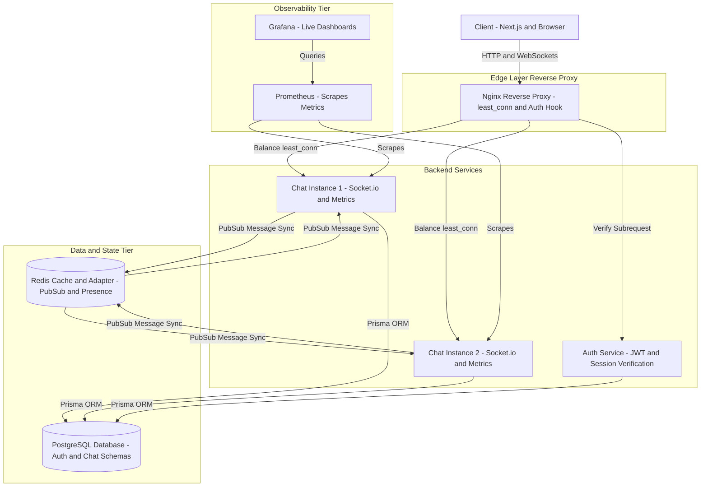

# 💬 TalkBuddy

> **High-Throughput, Horizontally Scaled Real-Time Chat Platform**  
> Sustaining 200+ concurrent connections with sub-50ms p95 delivery latency across multiple distributed Node.js instances.

[](https://nextjs.org/)
[](https://nodejs.org/)
[](https://socket.io/)
[](https://redis.io/)
[](https://www.postgresql.org/)
[](https://www.prisma.io/)
[](https://nginx.org/)
[](https://www.docker.com/)
[](https://prometheus.io/)
[](https://grafana.com/)

---

## 📌 Overview

**TalkBuddy** is an enterprise-grade, distributed real-time messaging application engineered to solve stateful WebSocket scalability, offline network unreliability, and cross-node communication bottlenecks.

Traditional chat architectures break when horizontally scaled because WebSockets maintain persistent, stateful TCP connections bound to a single server instance. TalkBuddy resolves this with a decoupled microservice architecture featuring an **Nginx API Gateway / Load Balancer**, **Redis Pub/Sub adapter**, **Redis TTL-backed presence**, **subrequest edge authentication**, and an **offline-first IndexedDB sync engine** with idempotent deduplication.

---

## 🏛️ System Architecture



---

## ✨ Key Architectural Features

### 1. Horizontal WebSocket Scaling & Load Balancing
* **Nginx Reverse Proxy with `least_conn`**: Distributes incoming WebSocket handshakes and HTTP REST traffic across multiple backend instances (`chat-1`, `chat-2`), avoiding connection hot spots.
* **Socket.io Redis Adapter**: Bridges instances using Redis Pub/Sub channels. When User A (connected to `chat-1`) messages User B (connected to `chat-2`), the message is published through Redis and dispatched seamlessly to User B's socket room.
* **Edge Subrequest Authentication (`auth_request`)**: Nginx intercepts incoming WebSocket connection handshakes and verifies the user session via an internal subrequest to `/auth/verify` before establishing the TCP connection. The validated `X-User-Id` is forwarded downstream.

### 2. Distributed Presence & TTL Heartbeats
* **Redis-Backed Heartbeats**: User presence is tracked in Redis (`presence:user:<id>`) with short-lived TTLs (15-second client heartbeat interval with 45-second Redis expiry).
* **Fault-Tolerant Status**: Prevents "zombie online" statuses in the event of client crashes, network disconnects, or server instance restarts.
* **Presence Broadcasts**: State changes (`online` / `offline`) are published across instances via Redis Pub/Sub.

### 3. Offline-First Architecture & Idempotent Message Sync
* **Client-Side Queueing (IndexedDB)**: If the client goes offline, messages are queued locally in browser IndexedDB with optimistic UI updates.
* **Sequential Flushing with Exponential Backoff**: Upon socket reconnection, unsent messages are replayed sequentially to guarantee FIFO order.
* **Idempotent Writes & Deduplication**: Every message is assigned a client-generated UUID (`clientMsgId`). PostgreSQL enforces uniqueness through database constraints (`@@unique([clientMsgId, senderId])`), preventing duplicate delivery even across aggressive network retries.

### 4. Metrics & Real-Time Observability
* **Prometheus Exporter**: Exposes Prometheus metrics via `prom-client` on `/metrics` tracking:
  * Total active WebSocket connections per instance.
  * Message event throughput (sent, delivered, acked).
  * Latency distributions.
  * Node.js event loop lag and process heap usage.
* **Grafana Dashboards**: Ready-to-use visual dashboard (`talkbuddy-grafana-dashboard.json`) for real-time monitoring and production capacity planning.

---

## 📊 Load Testing & Performance Benchmarks

A custom dual-ended load test harness ([`loadtest.v2.js`](./loadtest.v2.js)) was built to stress-test real bidirectional traffic between paired users across instances under high concurrency.

### Benchmark Setup
* **Concurrent Users**: 200 concurrent WebSockets (100 active bidirectional messaging pairs).
* **Target Throughput**: 200 messages/sec.
* **Duration**: 60 seconds (with 10-second warm-up excluded from latency calculations).
* **Topology**: 2 Node.js chat instances behind Nginx load balancer.

### Benchmark Results

```text
==================== BENCHMARK RESULTS ====================
Concurrent Users       : 200  (Peak connected: 200)
Total Messages Sent    : 11,918
Messages Acked OK      : 11,918 (100.00%)
Messages Errored       : 0 (0.00%)
Messages Timed Out (5s): 0 (0.00%)
Delivered to Receiver  : 11,918 (100.00%)
Send Rate (Actual)     : 199 msg/s (Target: 200 msg/s)
Load Generator Lag Max : 18 ms (Reliable test run)

--- Latency Profile ---
Ack Latency (ms)       : p50: 19ms   | p95: 46ms   | p99: 95ms
Delivery Latency (ms)  : p50: 20ms   | p95: 48ms   | p99: 99ms

--- Load Balancing & Cross-Instance Routing ---
Per-Instance Acks      : Instance 1: 5,899 (49.5%) | Instance 2: 6,019 (50.5%)
Cross-Instance Pairs   : 45 of 100 pairs routed across distinct instances via Redis
```

> **Takeaway**: TalkBuddy sustained **100% message delivery** with **zero packet loss**, maintaining a **p95 latency under 50ms** across balanced backend instances.

---

## 🛠️ Technology Stack

| Domain | Technology | Purpose |
|---|---|---|
| **Frontend** | Next.js 14 (App Router), TypeScript, Tailwind CSS, Lucide Icons | Responsive UI, state management, and real-time conversation views |
| **State & Offline** | Zustand, IndexedDB (`idb`) | Global state, offline message queue, optimistic local storage |
| **API Gateway & LB** | Nginx | Reverse proxy, SSL termination, `least_conn` load balancing, `auth_request` verification |
| **Backend Services** | Node.js (v20), Express, Socket.io | Microservices for authentication, messaging, and presence |
| **Pub/Sub & Cache** | Redis 7 (`@socket.io/redis-adapter`) | Cross-instance WebSocket message broadcasting, presence TTL keys |
| **Database** | PostgreSQL 15, Prisma ORM | Relational storage with dual schemas (`auth`, `chat`) and idempotent constraints |
| **Observability** | Prometheus, Grafana, `prom-client` | Metrics collection, event loop monitoring, visualization dashboards |
| **DevOps** | Docker, Docker Compose | Multi-container orchestration and environment parity |

---

## 📁 Repository Structure

```text
TalkBuddy/
├── api-gateway/              # Express API gateway routing HTTP services
│   ├── Dockerfile
│   ├── index.js
│   └── package.json
├── auth-backend/             # Authentication microservice
│   ├── controllers/          # Login, signup, verification handlers
│   ├── middlewares/          # JWT authentication middleware
│   ├── prisma/               # Prisma schema (auth database schema)
│   ├── routes/               # /auth and /users endpoints
│   ├── Dockerfile
│   └── package.json
├── chat-backend/             # Real-time chat & WebSocket microservice
│   ├── config/               # Database & Redis configurations
│   ├── controllers/          # Chat history and conversation APIs
│   ├── prisma/               # Prisma schema (chat database schema)
│   ├── routes/               # Message endpoints
│   ├── sockets/              # Socket.io handlers, presence, Redis adapter
│   ├── Dockerfile
│   └── package.json
├── frontend/                 # Next.js 14 client application
│   ├── app/                  # App router pages (auth, chat)
│   ├── components/           # UI components, ChatArea, ChatSidebar
│   ├── lib/                  # IndexedDB client, Axios client, utils
│   ├── store/                # Zustand stores (useAuthStore, useChatStore)
│   ├── Dockerfile
│   └── package.json
├── nginx/
│   └── nginx.conf            # Nginx reverse proxy, least_conn LB & auth subrequest config
├── prometheus/
│   └── prometheus.yml        # Prometheus scrape configurations
├── loadtest.v2.js            # Dual-ended high-concurrency load testing script
├── talkbuddy-grafana-dashboard.json # Exported Grafana monitoring dashboard
├── docker-compose.dev.yml    # Development multi-container orchestration
└── docker-compose.yml        # Production Docker Compose specification
```

---

## 🚀 Getting Started

### Prerequisites
* [Docker Desktop](https://www.docker.com/products/docker-desktop/) (v24+ recommended)
* [Node.js](https://nodejs.org/) (v20 LTS or higher)
* [Git](https://git-scm.com/)

---

### Step 1: Clone the Repository
```bash
git clone https://github.com/Shubhamkr585/TalkBuddy.git
cd TalkBuddy
```

---

### Step 2: Configure Environment Variables
Copy the sample environment files for each service:

```bash
# Auth Service
cp auth-backend/.env.example auth-backend/.env

# Chat Service
cp chat-backend/.env.example chat-backend/.env

# Frontend Client
cp frontend/.env.example frontend/.env
```

#### Default Configurations
* **`auth-backend/.env`**:
  ```env
  PORT=4000
  DATABASE_URL=postgresql://<DB_USER>:<DB_PASSWORD>@postgres:5432/talkbuddy?schema=auth
  JWT_SECRET=<your-jwt-secret>
  ```
* **`chat-backend/.env`**:
  ```env
  PORT=5000
  DATABASE_URL=postgresql://<DB_USER>:<DB_PASSWORD>@postgres:5432/talkbuddy?schema=chat
  REDIS_URL=redis://redis:6379
  JWT_SECRET=<your-jwt-secret>
  ```
* **`frontend/.env`**:
  ```env
  NEXT_PUBLIC_API_URL=http://localhost:5100/api
  NEXT_PUBLIC_SOCKET_URL=http://localhost:8080
  ```

---

### Step 3: Run with Docker Compose
Spin up all microservices, databases, Redis, Nginx, Prometheus, and Grafana in detached mode:

```bash
docker compose -f docker-compose.dev.yml up --build -d
```

Verify that all containers are healthy:
```bash
docker compose -f docker-compose.dev.yml ps
```

---

### Step 4: Service Endpoints

| Service | Host URL | Description |
|---|---|---|
| **Frontend Web App** | [http://localhost:3000](http://localhost:3000) | TalkBuddy Next.js chat client |
| **Nginx Gateway** | [http://localhost:8080](http://localhost:8080) | Reverse proxy & load balanced WebSocket endpoint |
| **API Gateway** | [http://localhost:5100](http://localhost:5100) | Microservice routing gateway |
| **Prometheus** | [http://localhost:9090](http://localhost:9090) | Metrics collector |
| **Grafana** | [http://localhost:3001](http://localhost:3001) | Metrics dashboards (Default: `admin` / `admin`) |

---

### Step 5: Database Migrations
If running for the first time, apply Prisma migrations to initialize the PostgreSQL schemas:

```bash
# Migrate Auth Schema
docker compose -f docker-compose.dev.yml exec auth-backend npx prisma db push

# Migrate Chat Schema
docker compose -f docker-compose.dev.yml exec chat-1 npx prisma db push
```

---

## 🧪 Running Load Tests

To execute the benchmark suite and evaluate latency, connection stability, and cross-instance routing:

```bash
# Run with 200 users for 60 seconds
USERS=200 DURATION=60 node loadtest.v2.js
```

To run with custom parameters:
```bash
USERS=100 DURATION=30 INTERVAL_MS=500 node loadtest.v2.js
```

---

## 🔒 Security & Reliability Design

1. **HttpOnly Cookie Authentication**: JWT tokens are transmitted via `HttpOnly`, `SameSite=Lax` cookies, preventing XSS-based credential theft.
2. **Internal Proxy Endpoints**: The Nginx auth verification route (`/_verify`) is flagged as `internal;`, blocking direct external access.
3. **Password Security**: Passwords hashed with `bcryptjs` using 10 salt rounds.
4. **Isolated Schemas**: Dual schemas (`auth` and `chat`) in PostgreSQL enforce bounded contexts between user accounts and messaging streams.
5. **Safe Data Policy**: All runtime credentials, environment files (`.env*`), and sensitive keys are ignored by `.gitignore` and never committed.

---

## 🤝 Contributing

Contributions, issues, and feature requests are welcome!  
Feel free to open an issue or submit a pull request.

1. Fork the Project
2. Create your Feature Branch (`git checkout -b feature/AmazingFeature`)
3. Commit your Changes (`git commit -m 'feat: Add some AmazingFeature'`)
4. Push to the Branch (`git push origin feature/AmazingFeature`)
5. Open a Pull Request

---

## 📄 License

This project is licensed under the [MIT License](LICENSE).
